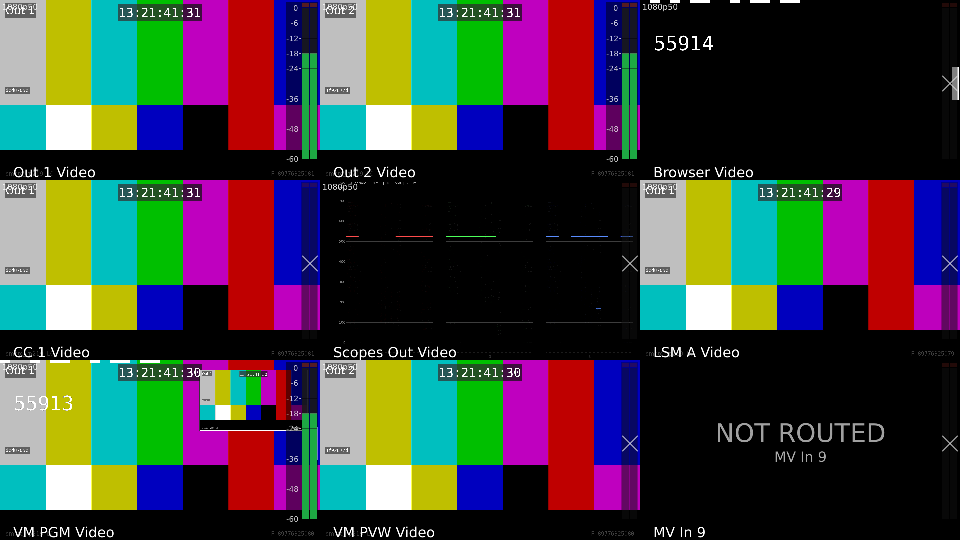

# lm-mxl-mixer

A CPU-only live vision mixer for [MXL](https://github.com/dmf-mxl/mxl), the
shared-memory media exchange of the EBU Dynamic Media Facility. It runs as an
MXL media function next to the functions of
[mxl-stack](https://github.com/LeeO86/mxl-stack), with the same conventions (one
container, host network, uid 1000, the `/Volumes/mxl` tmpfs, NMOS IS-04/IS-05
with the MXL transport, a web UI, Prometheus metrics, WebRTC previews through
MediaMTX, TSL tally), and is a drop-in alternative to
[FlowXer](https://github.com/firesh0ot/FlowXer) on hosts without an NVIDIA GPU.

It mixes at 10 bits straight in v210 (see [How it works](#how-it-works)).



*The stack's multiviewer on the test VM, with the mixer's programme (bottom
left: Out 1, Out 2 in a box, the browser source's counter as a luma-keyed DSK,
its audio bars from "VM PGM Audio") and preview.*

## What it does

- **MXL in and out at 10 bits.** Video inputs and key inputs are IS-05
  receivers (`video/v210`, or `video/v210a` fill + key). Outputs: PGM, PVW and
  clean feed of ME 1, PGM and PVW of every further ME, as v210 flows with NMOS
  senders, and programme audio. The house format comes from `MIXER_FORMAT`
  (default 1080p50; 720p, 1080p, 2160p at 23.98–60). Inputs of other sizes and
  rates are scaled and re-timed.
- **TAI-locked.** Output grain N is written at its TAI time, from the input
  grains one frame earlier; a late input is held (or black after
  `MIXER_HOLD_MAX_S`), and the output never waits for an input.
- **MEs** (1–4): programme and preview buses, cut, auto, T-bar, transitions
  `mix`, `dip`, `wipe` (7 patterns, soft edge, reverse), `push`, `slide`, with a
  duration; fade to black; re-entry of higher MEs. Transitions are computed per
  output frame inside the mixer, frame accurate.
- **Keyers**: upstream keyers per ME (luma key, linear key from a v210a source,
  PiP; DME box with position, size, crop and border), tied to the next
  transition or on their own (cut, auto); downstream keyers (luma, linear). Clean
  feed without DSKs and FTB.
- **Tally**: programme red, preview green (through re-entered MEs and keyers),
  over TSL UMD 5.0, `GET /api/v1/tally` and metrics.
- **Audio**: audio follows video (equal-power through transitions, silent with
  FTB) or one input passed through. A full audio mixer is
  [mxl-audio-mixer](https://github.com/LeeO86/mxl-audio-mixer)'s job.
- **Control**: a REST API with FlowXer's routes where there is an equivalent,
  a WebSocket state push, a web UI (buses, cut/auto, T-bar, transitions,
  keyers and DME boxes, FTB, inputs and outputs, tally receivers, config export
  and import, a WebRTC preview of PVW and PGM), Prometheus `/metrics`.

Details of every behaviour: [SPECIFICATION.md](SPECIFICATION.md).

## Run it next to mxl-stack

The image is built from this repository (nothing is pushed to a registry):

```bash
docker build -f docker/Dockerfile -t lm-mxl-mixer:dev .
```

[`deploy/compose.single-host.yaml`](deploy/compose.single-host.yaml) adds it to
mxl-stack's `compose/single-host` example (an override file; Compose anchors
don't cross files, so it spells out the NMOS and preview settings):

```bash
cd mxl-stack/compose/single-host
docker compose -f compose.yaml -f /path/to/lm-mxl-mixer/deploy/compose.single-host.yaml up -d vision-mixer
```

Then route sources into `VM In n Video` (and `VM In n Audio`), key sources into
`VM Key n Video`, and `VM PGM Video` / `VM PGM Audio` onwards, in the NMOS
crosspoint or with IS-05. The UI is on `http://HOST:8180/`.

**Ports** (host network, free in mxl-stack's port plan): web, API and metrics
`8180`, NMOS `3332`. Tally is sent over UDP to the configured TSL receivers; no
port is opened for it. The preview is published to the shared MediaMTX.

## Settings

The platform's (as every mxl-stack function):

| Variable | Default | |
| --- | --- | --- |
| `NMOS_REGISTRY_ADDRESS`, `NMOS_REGISTRY_PORT` | unset | Static registry (unset: no registration) |
| `NMOS_QUERY_ADDRESS`, `NMOS_QUERY_PORT` | registry, port + 1 | Query API for readiness |
| `NMOS_HOST_ADDRESS` | first routable IPv4 | Announced address (not loopback) |
| `NMOS_SEED` | `lm-mxl-mixer` | All NMOS ids, the output domain id and the flow ids derive from it |
| `NMOS_LABEL` | `Vision mixer` | Node label |
| `NMOS_PORT` | `3332` | Node and Connection APIs |
| `NMOS_DNS_SD` | `false` | mDNS (the `dns-sd` feature of mxl-nmos is not built in) |
| `WEB_PORT` | `8180` | UI, API, metrics |
| `MXL_DOMAIN_SCAN_PATH` | `/Volumes/mxl` | Where the domains are |
| `MXL_OUTPUT_DOMAIN_DIR` | `<scan path>/vision-mixer` | Own output domain |
| `MXL_CLEANUP_ON_EXIT` | `false` | Remove the own domain at shutdown |
| `MXL_HISTORY_MS` | `200` | Ring length of the output flows |
| `SHUTDOWN_TIMEOUT_S` | `10` | |
| `PREVIEW_PUBLISH_URL` | unset | MediaMTX RTSP base (unset: no preview) |
| `PREVIEW_PATH_PREFIX` | `vision-mixer` | Path of the mosaic: `<prefix>/mosaic` |
| `PREVIEW_WHEP_URL`, `PREVIEW_HLS_URL` | unset | Base URLs the browser uses |
| `MEDIAMTX_API_URL` | unset | (reported only) |
| `LOG_LEVEL` | `info` | |

The mixer's:

| Variable | Default | |
| --- | --- | --- |
| `MIXER_FORMAT` | `1080p50` | House format |
| `MIXER_INPUTS` | `8` | Video inputs (1–32) |
| `MIXER_KEY_INPUTS` | `2` | Key inputs (0–8) |
| `MIXER_MES` | `1` | MEs (1–4) |
| `MIXER_KEYERS_PER_ME` | `2` | Upstream keyers per ME (0–4) |
| `MIXER_DSKS` | `2` | Downstream keyers per ME (0–4) |
| `MIXER_CLEAN_FEED` | `true` | Clean feed output of ME 1 |
| `MIXER_ME_OUTPUTS` | `true` | PGM and PVW outputs of MEs 2–4 |
| `MIXER_LABEL_PREFIX` | `VM` | Prefix of every receiver and sender label |
| `MIXER_AUDIO` | `afv` | `afv`, `passthrough` or `off` |
| `MIXER_AUDIO_CHANNELS` | `2` | Programme audio channels |
| `MIXER_READ_OFFSET_GRAINS` | `1` | Input grains drawn this many grains back (latency) |
| `MIXER_INPUT_WAIT_US` | `5000` | How long to wait for input audio samples, and (with a read offset of 0) for an input grain |
| `MIXER_HOLD_MAX_S` | `10` | How long a late or gone input is held before black |
| `MIXER_THREADS` | half the cores, at most 4 | Drawing threads (strips) |
| `MIXER_PARALLEL` | `auto` | `auto` (strips only when a frame takes > 70% of the interval), `on`, `off` |
| `MIXER_STATE_DIR` | `/config` | `state.json` (operator state), `connections.json` (IS-05) |
| `PREVIEW_FPS`, `PREVIEW_KBPS` | `25`, `1500` | Preview mosaic |
| `TSL_TARGETS` | unset | TSL UMD 5.0 receivers, `host:port,...` (also `PUT /api/v1/tally/receivers`) |
| `TSL_SCREEN` | `0` | TSL screen index |
| `MIXER_DECIMATE` | on | `0`: strong downscales (7.5:1 and more) read every row (comparisons) |
| `MIXER_SIMD` | the CPU's best | `none`, `sse41` or `avx2`: cap the kernels (comparisons) |

## API

`/api/v1` on `WEB_PORT`; FlowXer's routes where there is an equivalent:

```bash
U=http://HOST:8180/api/v1; J='content-type: application/json'
curl -X POST $U/mixer/preview -H "$J" -d '{"me":1,"source":"in-2"}'
curl -X PATCH $U/panels/me-1/transition -H "$J" -d '{"type":"wipe","duration_ms":800,"wipe":{"pattern":"iris","soft":0.1}}'
curl -X POST $U/mixer/auto -H "$J" -d '{"me":1}'
curl -X POST $U/mixer/position -H "$J" -d '{"me":1,"position":0.5}'      # T-bar
curl -X PATCH $U/keyers/me-1-key-1 -H "$J" -d '{"mode":"pip","source":"in-3","dme":{"x":0.625,"y":0.0556,"w":0.3333,"h":0.3333,"border":{"width":4}}}'
curl -X POST $U/keyers/me-1-key-1/auto
curl -X PATCH $U/keyers/me-1-dsk-1 -H "$J" -d '{"mode":"linear","source":"key-1"}'
curl -X POST $U/mixer/fade-to-black -H "$J" -d '{"me":1}'
curl $U/state; curl http://HOST:8180/metrics
```

The full list (state, WebSocket, buses, take, cut, auto, T-bar, FTB,
transitions, next-transition ties, keyers, labels, tally and TSL receivers,
inputs, outputs, preview, config export and import, health) is in
[SPECIFICATION.md §3](SPECIFICATION.md#3-control).

Metrics: `lm_mixer_frames_total`, `lm_mixer_frames_missed_total` (output grains
not written), `lm_mixer_frames_late_total` (finished after the next frame's
time), `lm_mixer_frame_seconds` (histogram, all outputs of a frame),
`lm_mixer_mix_seconds{output}` (histogram, mix time per output frame),
`lm_mixer_parallel{output}`, `lm_mixer_threads`,
`lm_mixer_input_frames_{late,held,missed}_total{input}`, `lm_mixer_input_ok`,
`lm_mixer_tally{source}`, `lm_mixer_audio_*`, `lm_mixer_preview_*`,
`lm_mixer_nmos_registered`.

## How it works

```
 IS-05 routes ──► inputs (VideoReader per receiver: one grain back, late → newest, gone → hold → black)
                      │ only the inputs some output shows are read; grains are used in place (no copy)
 REST/WS ──► control: per ME a state machine (buses, transition, T-bar, keyers, FTB) ──┐
                                                                                        ▼ once per output frame, at TAI t(N)
 engine thread: ME frame(t) → scenes (layers: sources in boxes, clips, masks, keys, fills)
             → compositor plan (visibility, occlusion, borders; even pixels horizontally)
             → 10-bit renderer into the MXL grains: ME n … ME 2 (re-entry), ME 1 clean, PGM = clean + DSK/FTB, PVW
             → programme audio (AFV weights at both ends of the frame) → preview tap (8-bit mosaic → ffmpeg → RTSP)
```

### The compositor

`src/compositor/` is the pixel engine. Per output frame it turns the scene's
layers into a plan (which parts of which layer are visible, occlusion by opaque
layers above, borders in the z-order, clip rectangles, fills), builds the
scaling tables (area filter down, bilinear up, exact boxes for whole-number
ratios, weights in 1/1024) and draws the visible spans row by row, on one
thread while a frame takes under 70% of the frame interval and in parallel
strips only to keep up.

- **10-bit renderer** (`render10.rs`, `mixer10.rs`, `v210.rs`, `kernels10.rs`,
  `simd10.rs`, `scale10.rs`): draws straight into the v210 output grains.
  Scaled layers unpack their source rows into Y, Cb and Cr planes (SSSE3), sum
  rows one after the other into rows that stay in L1, and filter horizontally 8
  outputs at a time (AVX2 gather and `pmaddwd`); whole-number boxes use `u16`
  row sums folded with `phaddw`. Downscales of 7.5:1 or more read every n-th
  row. Tested against a floating-point reference (`tests10.rs`).
- **8-bit engine** (`render.rs`, `kernels.rs`, `formats.rs`, `color.rs`,
  `scale.rs`): draws the preview mosaic (PVW, PGM and source tiles, read
  straight from the v210 grains into I420; thumbnails of 7.5:1 and more read
  every n-th row).
- SIMD kernels are compiled for baseline, SSE4.1 and AVX2 and picked at run
  time (`MIXER_SIMD` caps them).

The control side (`src/vision/`) has the transition maths (transitions as layer
lists per progress, wipe patterns, audio weights) and the ME state machine
(ramps over whole frames, auto, T-bar, cut, FTB, keyer fades, tied keyers,
DSKs, clean feed, tally).

### 10 bits: native v210 kernels

Cuts, mixes, fills and hard wipes run on the v210 words without unpacking them;
keys, soft wipes and scaled boxes go through 16-bit samples, per span. See
[docs/v210.md](docs/v210.md) for how and where the time goes per scene.

## Measurements

Test VM: Infomaniak `a16-ram32-disk80-perf1`, 16 vCPU AMD EPYC Genoa (AVX2,
AVX-512), mxl-stack's single-host example running next to it. 1080p50, 5 video
outputs (PGM, PVW, clean, ME 2 PGM/PVW) and programme audio, preview mosaic at
25 fps. `tests/measure.py` (CPU from `/proc`, counters from `/metrics`) over
20 s per run, `tests/bench_live.py` for the scenes. % of one core:

| Routed inputs | cut | show: a mix every 2 s, 2 PiPs (0.35), luma DSK | max: soft iris wipe every 2 s, 4 PiPs (0.35), luma DSK |
| --- | --- | --- | --- |
| 4 | 19.8 % | 45.4 % | 77.1 % |
| 8 | 23.0 % | 48.5 % | 79.5 % |
| 16 | 23.7 % | 46.8 % | 74.5 % |

Every run: 50.0 fps, 0 output grains missed, 0 input grains late or missed.
The ffmpeg preview encoder adds 7 %. The number of inputs hardly matters
(inputs that no output shows aren't read); the cost is in what is visible:
fractional-size PiPs (~1.2 ms each) and soft wipes. The demo scene left on the
VM (PGM with a 1/3 PiP and a luma DSK, PVW, clean, ME 2, audio, preview) takes
33.5 % plus 6.9 % for ffmpeg; 1500 of 1500 PGM grains in 30 s, complete 5.7 ms
(median, p99 8.9 ms) after their TAI time.

Per-scene costs on one thread are in [docs/v210.md](docs/v210.md).

## Tests

```bash
cargo test --release                       # 101 unit tests: kernels vs reference, transitions, state machine, API, NMOS ids, TSL
cargo run --release --example bench10      # renderer benchmarks (scenes, grids of 4/8/16 sources, preview mosaic)
BIN=target/release LD_LIBRARY_PATH=/opt/mxl/lib python3 tests/e2e.py /Volumes/mxl/e2e
```

- **Unit**: the 10-bit renderer against a floating-point reference over random
  layouts (`tests10.rs`), the v210 and SIMD kernels against scalar twins,
  the 8-bit engine's tests, the transition maths and the ME state machine
  (ties, DSKs, clean feed), control (re-entry tally,
  audio weights, saved state), TSL packets, flow definitions.
- **End to end** (`tests/e2e.py`): `mxl-pattern` sources (v210, v210a, audio)
  and the mixer on a tmpfs; routing over the mixer's IS-05 API; pixel and level
  checks on PGM, PVW, clean and programme audio with `mxl-grab` through a cut,
  T-bar mix (and its equal-power audio), hard wipe, auto mix, linear DSK (not on
  the clean feed), PiP, re-entry and its tally, FTB (black and silent); no
  missing PGM grains; metrics; config export and import; SIGTERM (exit 143) and
  a restart that restores state and routes. 26 checks, all passing on the VM.
- **Tools** in the image: `mxl-pattern` (TAI-locked v210/v210a/audio test
  flows) and `mxl-grab` (pixels, PPM frames, grain timing and audio levels of
  any flow).

## Build

```bash
scripts/build-mxl.sh /opt/mxl            # libmxl at the platform pin (vcpkg; needs sudo for /opt)
cargo build --release                    # needs libclang (bindgen) and git (the mxl and mxl-nmos crates)
LD_LIBRARY_PATH=/opt/mxl/lib target/release/lm-mxl-mixer
```

The UI is one file, `web/index.html`, embedded at build time (no Node build).

## Licence

© 2026 Livemotion, released under the [MIT licence](LICENSE).

## Origin of the code

- `src/mxlio/domain.rs` and `scripts/build-mxl.sh`: from
  [LeeO86/mxl-audio-mixer](https://github.com/LeeO86/mxl-audio-mixer) (MIT,
  Copyright (c) 2026 Adrian Hilber),
  commit `f575066`.
- Libraries: the MXL SDK's Rust bindings (`mxl`, `mxl-sys`, Apache-2.0) at the
  platform pin `218ddaa`, [mxl-nmos](https://github.com/LeeO86/mxl-nmos)
  `v0.1.1` (MIT or Apache-2.0), axum, tokio. The image contains libmxl and
  Ubuntu's ffmpeg (x264) for the preview.

## Not done yet

- Clip players, stingers, frame grabs, snapshots, keyframed DME moves and drop
  shadows (FlowXer has them).
- Wipe patterns: 7 instead of SMPTE's 23; no wipe border.
- Scaled linear keys are filtered straight, not premultiplied (fringes at box
  edges are possible).
- Fractional DME sizes take the filter with weights (~1.2 ms per 1080p box);
  whole-number sizes the box path (~0.65 ms).
- Interlaced formats.
- The preview mosaic's PVW and PGM tiles (3:1) still read whole 1080p
  frames (~2.3 ms per preview frame); only thumbnails of 7.5:1 and more are
  decimated.
- Keyers come back off air after a restart.
